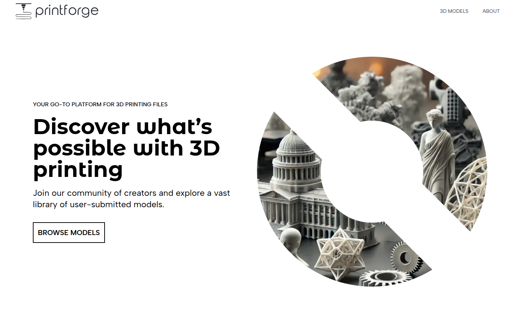
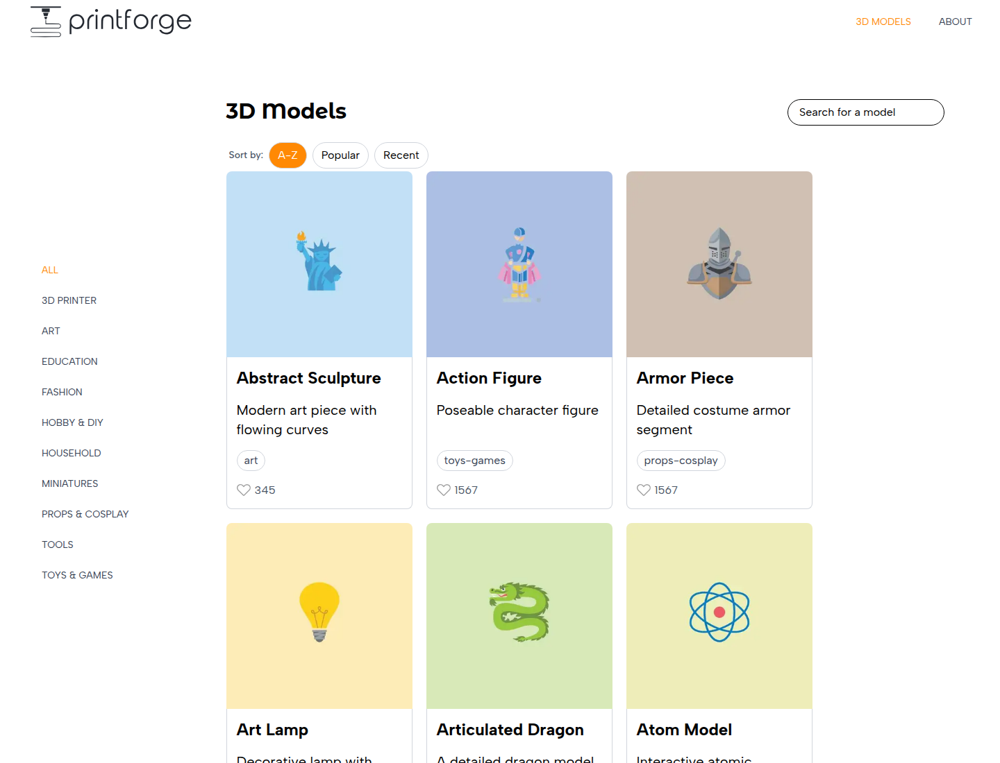
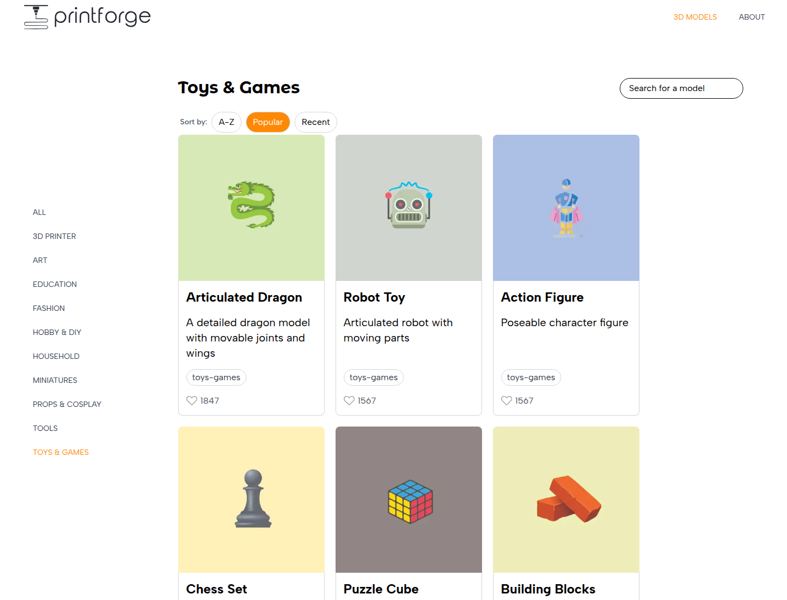
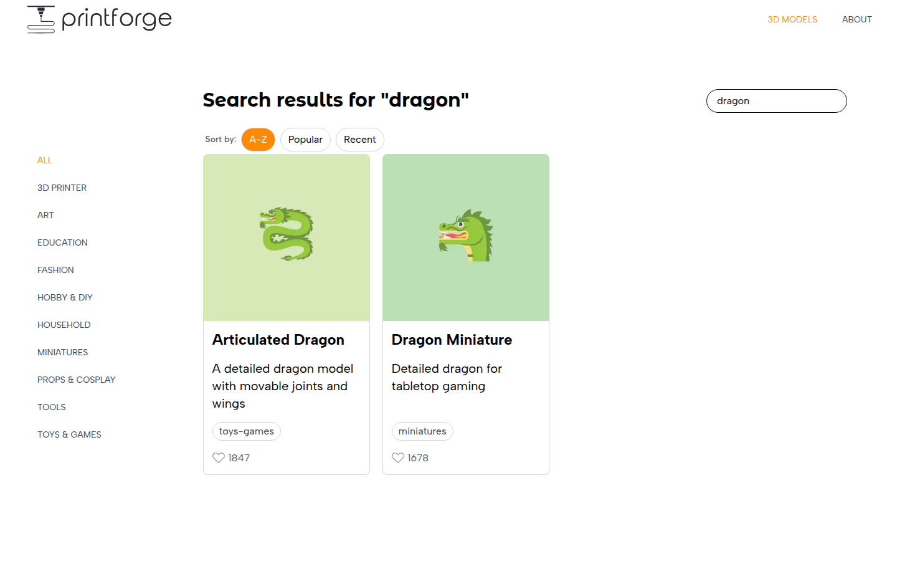
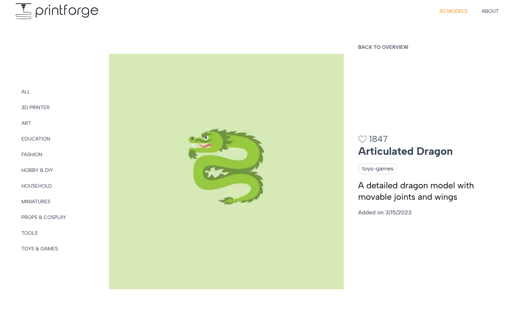
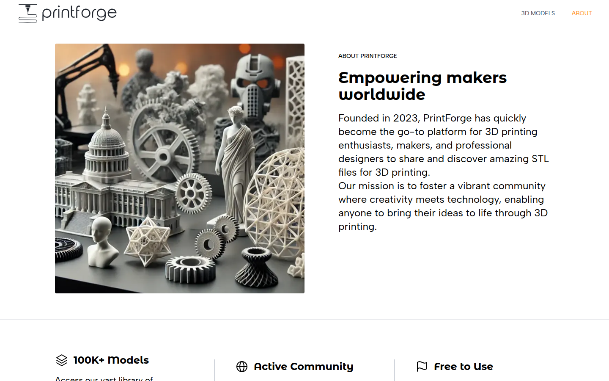
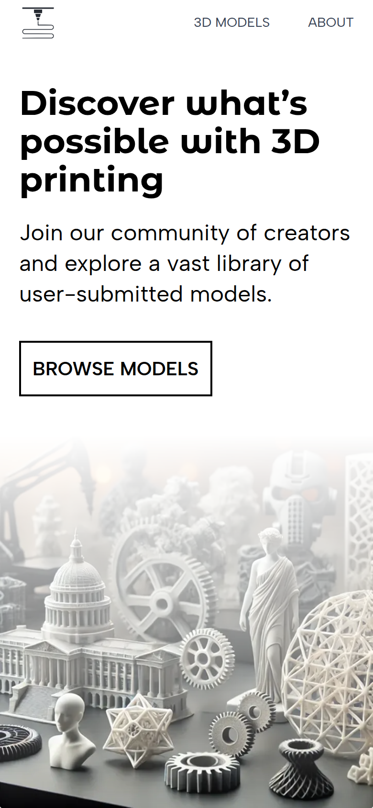
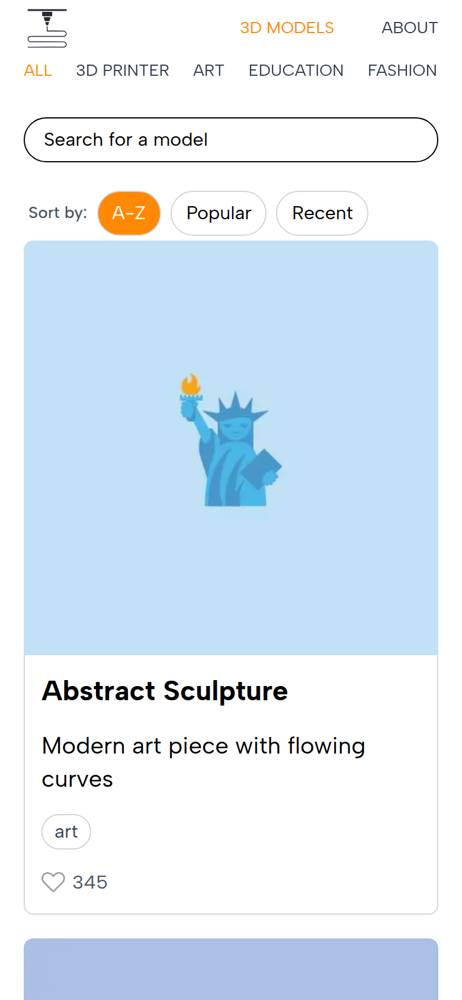

# PrintForge

A catalog for browsing 3D-printable models, built with the Next.js App Router, React Server Components, and SQLite. Search, filter, sort, and page through the library. All of that state lives in the URL, so every view can be bookmarked and shared.



## Features

- **Browse the catalog:** a responsive grid of model cards, 12 per page.
- **Filter by category:** 10 categories (Art, Miniatures, Tools, Toys & Games, …) in a sidebar on desktop and a horizontal scroller on mobile.
- **Search:** case-insensitive matching on model name and description. Works on its own or inside a category.
- **Sort:** A–Z, Popular (by likes), or Recent (by date added).
- **Model detail pages:** large image, like count, category tag, description, and the date the model was added.
- **URL-driven state:** `search`, `sort`, and `page` are query parameters. Invalid values are cleaned up with a redirect: an out-of-range page snaps to the nearest valid page, and an unknown sort falls back to A–Z.
- **Loading and error states:** an overlay while a search or sort is pending (via `useTransition`), route-level `loading.tsx` spinners, and custom 404 pages for unknown models, categories, and routes.

## Screenshots

| All models                                          | Category view (sorted by popularity)                    |
| --------------------------------------------------- | ------------------------------------------------------- |
|      |  |
| **Search results**                                  | **Model detail**                                        |
|  |  |

**About page**



**Mobile**

<p>
  
  &nbsp;&nbsp;
  
</p>

## Tech stack

| Layer     | Choice                                                                     |
| --------- | -------------------------------------------------------------------------- |
| Framework | [Next.js 16](https://nextjs.org) (App Router, Turbopack)                   |
| UI        | React 19, Server Components with small client components for interactivity |
| Styling   | Tailwind CSS v4                                                            |
| Data      | SQLite via [better-sqlite3](https://github.com/WiseLibs/better-sqlite3)    |
| Language  | TypeScript                                                                 |
| Tooling   | ESLint, Prettier, `tsx` (to run the seed scripts)                          |

## Getting started

### Prerequisites

- **Node.js 20.9 or newer** (required by Next.js 16)
- npm

`better-sqlite3` is a native module. On most platforms npm downloads a prebuilt binary. If none exists for your platform, it compiles from source and needs Python, `make`, and a C++ compiler.

### 1. Install dependencies

```bash
npm install
```

### 2. Create and seed the database

The app reads from a SQLite file called `printforge.db` in the project root. It is gitignored, so create it from the bundled JSON data:

```bash
npm run seed
```

This runs the category and model seed scripts in `lib/seeds/`. Each one creates its table if it doesn't exist and uses `INSERT OR REPLACE`. Re-running is safe and resets the rows to match the JSON files.

### 3. Start the dev server

```bash
npm run dev
```

Open [http://localhost:3000](http://localhost:3000).

## Scripts

| Command                | Description                         |
| ---------------------- | ----------------------------------- |
| `npm run dev`          | Start the development server        |
| `npm run build`        | Create a production build           |
| `npm run start`        | Serve the production build          |
| `npm run lint`         | Run ESLint                          |
| `npm run seed`         | Create and seed the SQLite database |
| `npm run format:check` | Check formatting with Prettier      |
| `npm run format:write` | Format all files with Prettier      |

## Routes

| Route                              | Description                     |
| ---------------------------------- | ------------------------------- |
| `/`                                | Landing page                    |
| `/3d-models`                       | All models                      |
| `/3d-models/categories/[category]` | Models in one category, by slug |
| `/3d-models/[id]`                  | A single model                  |
| `/about`                           | About PrintForge                |

Both listing routes accept these query parameters:

| Parameter | Values                       | Default |
| --------- | ---------------------------- | ------- |
| `search`  | any text                     | none    |
| `sort`    | `alpha`, `popular`, `recent` | `alpha` |
| `page`    | a positive integer           | `1`     |

For example, `/3d-models/categories/miniatures?search=dragon&sort=popular&page=1`.

## Project structure

```
app/                     # Routes (App Router)
  page.tsx               # Landing page
  about/                 # About page
  3d-models/
    layout.tsx           # Category sidebar + content area
    page.tsx             # All models
    [id]/                # Model detail
    categories/[category]/   # Models filtered by category
component/               # React components (cards, grid, search, sort, pagination, nav)
lib/
  db.ts                  # better-sqlite3 connection
  models.ts              # Model queries: list, count, search, sort, paginate
  categories.ts          # Category queries
  constants.ts           # MODELS_PER_PAGE
  types.ts               # Model and Category types
  utils/utils.ts         # Search-param parsing, page clamping, URL building
  data/                  # Seed data (models.json, categories.json)
  seeds/                 # Scripts that create and populate the database
public/img/              # Logos, hero images, and model thumbnails
docs/screenshots/        # Images used in this README
```

## Data model

```sql
CREATE TABLE categories (
  slug TEXT NOT NULL PRIMARY KEY,
  name TEXT NOT NULL
);

CREATE TABLE models (
  id          INTEGER PRIMARY KEY,
  name        TEXT NOT NULL,
  description TEXT NOT NULL,
  likes       INTEGER NOT NULL DEFAULT 0,
  image       TEXT NOT NULL,      -- path under /public, e.g. /img/models/1.jpg
  category    TEXT NOT NULL,      -- categories.slug
  dateAdded   DATETIME NOT NULL DEFAULT CURRENT_TIMESTAMP
);
```

To add or change models, edit `lib/data/models.json` (and put the image in `public/img/models/`), then run `npm run seed` again.
